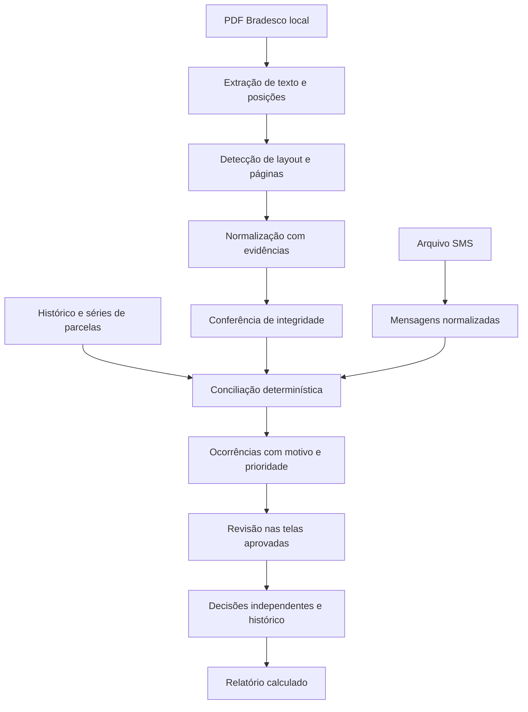

# Arquitetura recomendada

Status: proposta para implementação incremental, não infraestrutura já instalada.
Requisito posterior: dados financeiros exclusivamente locais, inclusive no Pages.
Para esse modo, priorizar processamento no navegador e persistência local; API,
PostgreSQL, worker de servidor e storage em nuvem ficam como alternativa futura,
dependente de mudança explícita de requisito. Ver `privacidade-publicacao.md`.
Data: 12/10/2026. Critério principal: confiabilidade financeira e preservação
da experiência aprovada, com baixo custo operacional inicial.

## Decisão

Começar com **monólito modular em TypeScript**, motor de domínio puro e
processamento de documentos separado da requisição web. Uma base de código e
contratos compartilhados reduzem divergências; módulos claros permitem extrair
serviços quando volume, segurança ou custos justificarem.

Não iniciar por microserviços: nesta fase a maior incerteza é interpretar
corretamente documentos e regras, não escalar requisições. Também não usar IA
como calculadora ou construir autenticação artesanal.

| Camada | Escolha proposta | Motivo / momento |
| --- | --- | --- |
| Interface | TypeScript + React + Vite | Componentes testáveis; migrar uma tela por vez, preservando CSS, conteúdo e navegação |
| Domínio | Pacotes TypeScript puros | Valores, parcelas, integridade, conciliação e ocorrências sem dependência de UI ou banco |
| PDF | PDF.js, em worker local no primeiro incremento | Extrair texto/posições e renderizar evidência; nenhum upload externo para validar parser |
| API | Node 24 LTS + Fastify + contratos JSON Schema | Limites de entrada, respostas consistentes e autorização centralizada quando houver persistência |
| Dados | PostgreSQL + migrações versionadas | Transações, vínculos, histórico, restrições e isolamento |
| Documentos | Abstração de armazenamento privado; diretório restrito local e objeto privado em produção | Trocar armazenamento sem alterar regras, controlar acesso e retenção |
| Jobs | Worker com jobs duráveis no PostgreSQL inicialmente | Retomada e idempotência sem depender de mais infraestrutura |
| Escala posterior | BullMQ + Redis se volume justificar | Separar coordenação dos jobs; não enviar conteúdo financeiro dentro da fila |
| Identidade | Provedor OIDC mantido, escolhido antes do multiusuário | Sessões seguras, recuperação e MFA sem manter senhas próprias |
| Testes | Test runner unitário, contratos/API, banco real isolado e Playwright | Provar invariantes financeiros, isolamento e fluxos na UI |

React admite adoção incremental em um projeto existente; Vite oferece suporte
a TypeScript/React. Isso sustenta a estratégia de migração, sem exigir refazer
todas as telas. [React](https://react.dev/learn/add-react-to-an-existing-project),
[Vite](https://vite.dev/guide/).
PDF.js fornece parsing/renderização; não fornece um parser de fatura Bradesco.
O adaptador de layout e sua validação são responsabilidade do Audita.
[PDF.js](https://mozilla.github.io/pdf.js/).
Fastify oferece validação e serialização por schemas; a segurança ainda exige
regras de autorização e implementação correta.
[Fastify](https://fastify.dev/docs/latest/Reference/Validation-and-Serialization/).
Node 24 está listado como LTS; adotar uma versão corrigida e fixada no início
da implementação. [Node](https://nodejs.org/en/about/previous-releases).

## Estrutura futura

```text
apps/web/                 telas, componentes e adaptador de dados
apps/api/                 identidade, autorização e casos de uso
apps/worker/              leitura, normalização e execução de regras
packages/domain/          valores, parcelas, conciliação e integridade
packages/contracts/       schemas e tipos de entrada/saída
packages/import-bradesco/ detecção e interpretação de layouts conhecidos
packages/import-sms/      leitura e normalização TXT/CSV
packages/storage/         arquivos privados, retenção e acesso
tests/fixtures/           somente exemplos sintéticos/sanitizados revisados
reference/               protótipo imutável
```

Essa árvore não é scaffold criado nesta missão. Antes do backend, o primeiro
adaptador e o domínio podem rodar localmente e ser conectados ao HTML existente.
Extrair CSS e funções só quando houver comparação com a referência e benefício
concreto. Migrar componentes sem substituir tokens, textos, gráficos ou navegação
por um kit visual genérico. PWA e cache offline entram depois: não armazenar
documentos sensíveis no cache do service worker por padrão.

## Caminho dos dados



Integridade pendente permite inspecionar e corrigir; o relatório permanece
provisório e não recebe selo de conferido. Processo deve distinguir `recebido`,
`extraindo`, `extraído`, `integridade_pendente`, `conciliando`, `pronto_para_revisão`,
`concluído`, `falhou` e `cancelado`. Conclusão não significa todas as compras
reconhecidas; o relatório informa quais dimensões foram verificadas.

## Modelo de dados proposto

| Entidade | Conteúdo essencial |
| --- | --- |
| Conta e usuário | Contexto de isolamento, membros e permissões; sem pressupor compartilhamento entre adicionais |
| Pessoa responsável | Identidade e vínculo à conta |
| Cartão | ID interno, final de quatro dígitos, emissor, modelo, estado, datas e predecessor |
| Vínculo de responsável | Cartão, pessoa e período de vigência |
| Auditoria mensal | Competência, estado, versão das regras e data de conclusão |
| Documento | Hash, origem, versão do parser, páginas, armazenamento restrito e status |
| Fatura e seção de cartão | Competência, fechamento/vencimento, cartão, totais declarados e equação de integridade |
| Lançamento | Descritor original, datas, centavos, moeda, tipo, cartão e referência de origem |
| Mensagem SMS | Data, descritor, valor, cartão sugerido e evidência minimizada |
| Compra / série / parcela | Compra original, índice/quantidade, vínculo aos lançamentos e projeções |
| Evidência | Documento/página/região ou mensagem/linha, trecho minimizado e versão da extração |
| Correspondência | Relação entre registros, critérios, versão, confiança e ambiguidade |
| Ocorrência | Tipo, prioridade, registros afetados, motivo, estado e versão da regra |
| Reconhecimento | Estado próprio por compra/lançamento e autoria |
| Classificação e correção | Estabelecimento, categoria, responsável, origem e confirmação manual |
| Repasse e alocação | Pessoa, valor, data, competência/obrigação, estornos e histórico |
| Evento de decisão | Ator, data, objeto, valores anteriores/novos, motivo e evidências |

Todos os registros pertencem a uma conta. Chaves compostas/restrições impedem
relações entre contas. Final de cartão e nome do estabelecimento não são IDs.
Uma fatura pode ter várias seções; várias faturas/PDFs podem representar dados
sobrepostos. A modelagem deve preservar essa proveniência sem duplicar despesa.

Contrato mínimo ilustrativo de extração, a validar no primeiro layout:

```json
{
  "documentId": "doc-sintetico",
  "parserVersion": "bradesco-layout-1@1",
  "status": "integridade_pendente",
  "entries": [{
    "id": "lancamento-1",
    "cardId": null,
    "cardLast4": "3268",
    "postedDate": "2026-10-04",
    "purchaseDate": null,
    "descriptionRaw": "LOJA EXEMPLO 02/05",
    "amountMinor": 3990,
    "currency": "BRL",
    "kind": "installment",
    "installment": { "index": 2, "count": 5, "seriesId": null },
    "source": { "page": 2, "region": [10, 20, 180, 35] }
  }],
  "integrity": { "declaredMinor": 3990, "calculatedMinor": 3990, "differenceMinor": 0 },
  "warnings": ["Compra original e série ainda não vinculadas"]
}
```

Campos desconhecidos permanecem `null` e geram pendência explicável. Regiões
precisam ter convenção explícita de coordenadas na implementação. Hashes devem
ser restritos ao contexto da conta; não revelar a outros usuários que um arquivo
já existe. Total coincidente não elimina warnings de extração incompleta.

## PDF e conciliação

1. Validar formato, tamanho, páginas e limites de tempo/memória; tratar PDFs
   protegidos sem salvar senha. Nunca executar scripts ou anexos do PDF.
2. Extrair tokens com página/posição. Detectar layout conhecido e registrar versão.
3. Separar cabeçalhos, lançamentos, subtotais e ofertas. Tratar descrições quebradas,
   colunas, anos inferidos, parcelas, negativos, ajustes e moeda estrangeira.
4. Conferir cobertura de páginas/seções, contagem e equação de total. Layout
   desconhecido falha de forma explícita, sem produzir sucesso genérico.
5. Digitalização sem texto exige OCR local em uma etapa posterior. Não aprovar
   centavos com OCR de baixa confiança; pedir revisão. Biblioteca e desempenho
   de OCR dependem dos exemplos e ainda não foram escolhidos.
6. Conciliação considera cartão interno, valor, datas, descritor e séries históricas.
   Candidatos concorrentes ficam ambíguos. Um SMS não explica duas compras
   independentes; vínculo de uma compra a suas parcelas é uma relação própria.
7. Priorizar duplicidade forte, compra inesperada após cancelamento e valor
   divergente; ausência isolada de SMS não é alerta de fraude. Não excluir cobrança
   porque “parece repetida”.

## Persistência, jobs e isolamento

Primeira validação roda localmente, sem documentos em nuvem. Ao introduzir
persistência, usar transações atômicas e chave de idempotência por conta,
documento, parser e execução. Nova versão cria execução rastreável; não duplica
lançamentos nem apaga decisões. Jobs duráveis têm limite de tentativas,
heartbeat/lease, cancelamento e retomada após falha. Fila guarda IDs, não PDF/SMS.
Se a carga exigir BullMQ, manter a mesma semântica de idempotência.
[BullMQ](https://docs.bullmq.io/).

Aplicar autorização na API e políticas por linha no banco como defesa adicional.
RLS não protege automaticamente contra proprietários/superusuários: usar papel
de execução sem bypass e testar acessos cruzados, inclusive no worker.
[PostgreSQL RLS](https://www.postgresql.org/docs/current/ddl-rowsecurity.html).

Objetos privados com autorização por conta, criptografia e URLs curtas quando
necessário. Documentos não ficam no diretório público. Credenciais fora do Git;
logs apenas com IDs técnicos minimizados. Revisar acesso, retenção, exclusão,
restauração de backup e trilhas de alteração antes de uso comercial. Um log de
decisões restrito não exige conservar os documentos indefinidamente.

## Dependências e decisões ainda abertas

- Exemplos locais/sanitizados de layouts Bradesco: Aeternum, Infinite, adicionais,
  cancelados, créditos e reemissões. Sem exemplos não é possível prometer cobertura.
- Verificar PDFs nativos, protegidos e digitalizados; priorizar um layout nativo.
- Definir formatos reais dos históricos de SMS, encodings e convenção de data.
- Confirmar regras de repasses/competência e comportamento de créditos/excedentes.
- Selecionar identidade, hospedagem, armazenamento e política de retenção antes
  da fase comercial. Nenhum serviço foi contratado ou conectado nesta missão.
- IA é opcional e posterior ao baseline determinístico; não é dependência para
  a primeira auditoria. Serviços externos só após autorização para os dados envolvidos.
- Definir suporte mínimo de iOS/Safari, direitos das imagens e tipografia antes
  de firmar a referência visual de produção.

